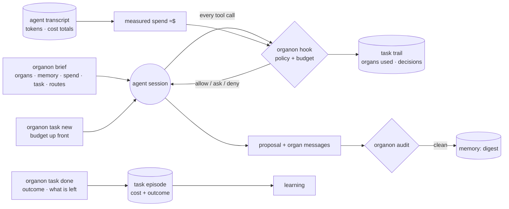

# Intelligence (`organon`): budget, policy, routes, audit

Status: **v0.1 (2026-11-13)**. Code: [`crates/organon-core`](../../crates/organon-core) (pure) and [`crates/organon-cli`](../../crates/organon-cli) (the `organon` binary).

## What it does

| Part | Rule | Why |
|---|---|---|
| **Budget** | Declared up front per task (effort `lookup` $1 / 15 min, `compare` $5 / 1 h, `deep` $15 / 3 h, all in [policy](../../policy/default.json)). Warn once at 80%, stop at 100%. A stop is final: work is denied with "do not retry", wrap-up stays allowed (git, mneme, organon, file edits). | Paperclip's open issues show budget stops retried as transient failures, re-burning the same budget ([#14780](https://github.com/paperclipai/paperclip/issues/14780), [#18120](https://github.com/paperclipai/paperclip/issues/18120)). |
| **Measured spend** | Read from the agent's transcript: every request's tokens, and the agent's own cost totals. Between totals, one rate per model calibrated on the latest total, applied to tokens weighted by Anthropic's price *ratios* (cache read 0.1×, cache write 1.25× / 2×, output 5×). | Totals are written only when a session starts or resumes. On a real session the calibrated rate moved 0.6% between two totals, and summed requests matched totals within 1%. |
| **Energy** | The brief shows how much context every turn re-reads and what the next turn costs; above 200k tokens it says to start the next independent step in a fresh session. | In a long session, re-reading the context dominates: 193M cache-read tokens against 0.7M output on the session that built this. |
| **Policy** | Allow / ask / deny per command, file write or tool name; the strictest part of a compound command wins. Rules that guard an **approval class** carry a `class`: `push-main` (incl. a bare `git push` on `main`, read from `.git/HEAD`), `deploy` (Vercel, Fly, Supabase, Netlify, Cloudflare, Firebase, Railway, Render; also through `npx`/`dlx`), `send` (mail, the Telegram bot API, package publishing, MCP send/reply tools, and a `gh pr merge` that skips the checks or names another repository by flag or URL), `merge` (a plain `gh pr merge` in the folder it runs in, so a person can let merges through in their own repositories without lifting `send` there), `delete`, `secrets`, `paid`. Those rules are a floor: the built-in ones apply even with an older or edited `policy.json`. A person can lift one class in named repositories with `exceptions` (`{"class": "push-main", "repo": "*/mneme-memory", "reason": "…"}`): an `ask` rule of that class then does not count for a command working in a repository whose folder matches (`cd` and `git -C` are followed; Git Bash `/c/…` paths are understood). An exception never lowers a `deny`, never applies when the folder is unknown, and the fail-safe ignores it. Deny hand edits of the memory's append-only log and generated projections. | Memory invariants 1 and 2 are now enforced where an agent acts, not only documented. A guard rail, not a sandbox: the agent's permission system stays the security boundary. |
| **Fail closed** | If the hook cannot decide (crash, panic, malformed event, unreadable policy, or slower than its 8 s deadline, `$ORGANON_HOOK_DEADLINE_MS`), it denies an approval-class action with the reason, and allows anything else as before. A malformed event is still read for its tool and command. | Claude Code treats a hook that errors or times out as non-blocking, so a failure used to let a push to `main` through unchecked. |
| **Routes** | Tools first (`check`), then two model tiers: cheap (`scan`, `extract`, `verify`), strong (`plan`, `judge`, `write`, `code`). `verify` never goes to the producer's own model. | Combining routing and cascading beats either, and quality estimates are the crux ([2410.10347](https://arxiv.org/abs/2410.10347)); a third model in a cascade rarely helps, 118 of 135 comparisons ([2605.06350](https://arxiv.org/abs/2605.06350)); evaluators favour their own outputs ([2404.13076](https://arxiv.org/abs/2404.13076)). |
| **Audit** | Before digest: inferred claims at ≥ 0.8 confidence must cite evidence; evidence produced by the proposal's own model is "self-verified"; cited observations must exist; organ messages must conform; every observation names its producer. Exit 1 on findings. | Models struggle to correct themselves without external feedback ([2310.01798](https://arxiv.org/abs/2310.01798); contested under zero temperature and neutral prompts, [2406.15673](https://arxiv.org/abs/2406.15673)). The audit is that external feedback, from the protocol alone. |
| **Episodes** | `task done` writes a protocol `Episode` (kind `task`): goal, effort, budget, organs used, outcome, tokens, ≈$, seconds. | What learning needs to calibrate budgets and routes from outcomes. |

## Paperclip: evaluated, not adopted (for now)

[Paperclip](https://github.com/paperclipai/paperclip) is a control plane for companies of agents: org charts, tickets, budgets, approvals, an activity log. It is a Node.js 24 server with a React UI and PostgreSQL, and it manages the organization agents work in, leaving prompts, models and how a task is done to the agents. For one person with one coding agent and CLI organs, that is overhead (its own guide says so for single-agent work), and its budget enforcement is still contested by open issues.

**Taken from it:** scoped budgets with a warning threshold and a hard stop, approvals as a policy decision, an append-only trail per task. **Left open:** if organon ever runs many agents around the clock, `organon` tasks map onto Paperclip issues and organs onto its adapters ("if it can receive a heartbeat, it's hired"). Research run and evidence: in memory, `repo:paperclipai/paperclip`.

## Organ discovery

Like git subcommands: an organ is an executable named `organon-<organ>` on `PATH`; the memory is `mneme` (or `$ORGANON_MEMORY`), with its folder set once by `organon init --memory <dir>`. Replacing an organ means putting another program with that name earlier on `PATH`.

## Limits

- Money is measured for Claude Code only; another agent needs its own transcript reader. Without one, only time is budgeted.
- A task belongs to the session it was declared in. `task new` finds that session's transcript from `CLAUDE_CODE_SESSION_ID`, which Claude Code sets for every command, or `ORGANON_SESSION_ID` (for a runner or another agent). Without either, it uses the one session the hook has recently seen in the current folder; with several running there it meters none and says so, rather than guessing. Each session's hook writes only its own record (`~/.organon/sessions/<id>.json`; the shared `session.json` is gone), so parallel sessions never overwrite each other. `organon spend --sessions` lists every session with its own spend; `--session <id>` shows one. The hook enforces the budget in that session only, so parallel sessions never stop each other. `brief`, `audit` and `task done` without a name also act on that session's task (or one no session claims), never another session's; run outside a session with several tasks open, `task done` asks for a name instead of guessing. A task declared outside an agent session has no meter and is not enforced.
- A new session may not have written a cost total yet. Its prices then come from the newest total for the same model in other sessions' transcripts, since a model's price is the same in every session.
- After a stop, wrap-up stays allowed: file edits; reading and moving around (`cd`, `ls`, `cat`, `grep`); `cargo fmt`, `cargo clippy` and `cargo test`; `git`; `gh run` and `gh pr view`/`checks`; `mneme` and `organon`. The stop message lists these, so the agent commits what is done instead of abandoning it.
- A stop can lag up to 30 s behind the spend that caused it (the hook re-measures at most that often).
- Time is wall-clock: a task left open over a break uses its time budget. Close tasks, or pass `--minutes 0` for no time limit.
- The policy reads commands as written; `bash -c`, scripts and aliases get past it. A bare `git push`, and a refspec whose source is `HEAD` or `@` (`git push origin HEAD`, `+@`, `HEAD:x`), are judged by the branch in `.git/HEAD`; a bare push assumes git's default `push.default=simple` (an upstream with another name is not seen).
- The deadline cannot cover a hook that never starts (organon missing from `PATH`): Claude Code then lets the call through.
- The audit checks structure, not truth: a cited passage can still be misread. Research verifies quotes; entailment checking is an open question.
