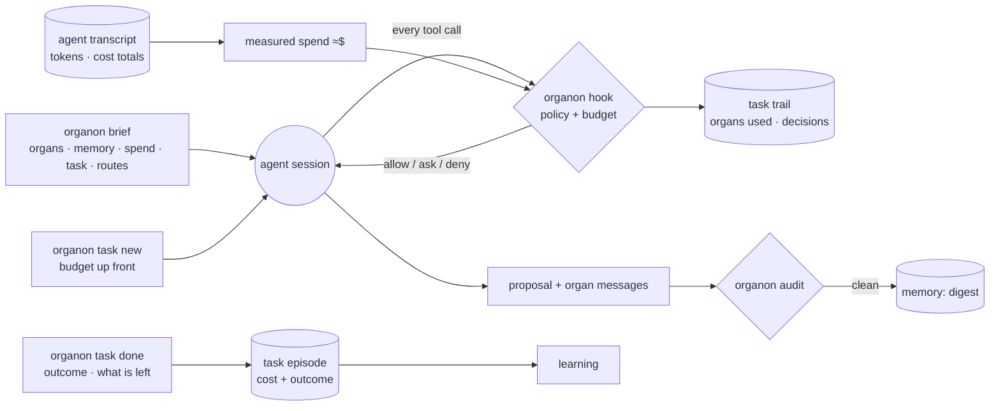

# Intelligence (`organon`): budget, policy, routes, audit

Status: **v0.1 (2026-11-13)**. Code: [`crates/organon-core`](../../crates/organon-core) (pure) and [`crates/organon-cli`](../../crates/organon-cli) (the `organon` binary).

## What it does

| Part | Rule | Why |
|---|---|---|
| **Budget** | Declared up front per task (effort `lookup` $1 / 15 min, `compare` $5 / 1 h, `deep` $15 / 3 h, all in [policy](../../policy/default.json)). Warn once at 80%, stop at 100%. A stop is final: work is denied with "do not retry", wrap-up stays allowed (git, mneme, organon, file edits). | Paperclip's open issues show budget stops retried as transient failures, re-burning the same budget ([#14780](https://github.com/paperclipai/paperclip/issues/14780), [#18120](https://github.com/paperclipai/paperclip/issues/18120)). |
| **Measured spend** | Read from the agent's transcript: every request's tokens, and the agent's own cost totals. Between totals, one rate per model calibrated on the latest total, applied to tokens weighted by Anthropic's price *ratios* (cache read 0.1×, cache write 1.25× / 2×, output 5×). | Totals are written only when a session starts or resumes. On a real session the calibrated rate moved 0.6% between two totals, and summed requests matched totals within 1%. |
| **Energy** | The brief shows how much context every turn re-reads and what the next turn costs; above 200k tokens it says to start the next independent step in a fresh session. | In a long session, re-reading the context dominates: 193M cache-read tokens against 0.7M output on the session that built this. |
| **Policy** | Allow / ask / deny per command or file write; the strictest part of a compound command wins. Defaults ask before force-push, hard reset, recursive delete, public repo creation; deny hand edits of the memory's append-only log and generated projections. | Memory invariants 1 and 2 are now enforced where an agent acts, not only documented. A guard rail, not a sandbox: the agent's permission system stays the security boundary. |
| **Routes** | Tools first (`check`), then two model tiers: cheap (`scan`, `extract`, `verify`), strong (`plan`, `judge`, `write`, `code`). `verify` never goes to the producer's own model. | Combining routing and cascading beats either, and quality estimates are the crux ([2410.10347](https://arxiv.org/abs/2410.10347)); a third model in a cascade rarely helps, 118 of 135 comparisons ([2605.06350](https://arxiv.org/abs/2605.06350)); evaluators favour their own outputs ([2404.13076](https://arxiv.org/abs/2404.13076)). |
| **Audit** | Before digest: inferred claims at ≥ 0.8 confidence must cite evidence; evidence produced by the proposal's own model is "self-verified"; cited observations must exist; organ messages must conform; every observation names its producer. Exit 1 on findings. | Models struggle to correct themselves without external feedback ([2310.01798](https://arxiv.org/abs/2310.01798); contested under zero temperature and neutral prompts, [2406.15673](https://arxiv.org/abs/2406.15673)). The audit is that external feedback, from the protocol alone. |
| **Episodes** | `task done` writes a protocol `Episode` (kind `task`): goal, effort, budget, organs used, outcome, tokens, ≈$, seconds. | What learning needs to calibrate budgets and routes from outcomes. |

## Paperclip: evaluated, not adopted (for now)

[Paperclip](https://github.com/paperclipai/paperclip) is a control plane for companies of agents: org charts, tickets, budgets, approvals, an activity log. It is a Node.js 24 server with a React UI and PostgreSQL, and it manages the organization agents work in, leaving prompts, models and how a task is done to the agents. For one person with one coding agent and CLI organs, that is overhead (its own guide says so for single-agent work), and its budget enforcement is still contested by open issues.

**Taken from it:** scoped budgets with a warning threshold and a hard stop, approvals as a policy decision, an append-only trail per task. **Left open:** if organon ever runs many agents around the clock, `organon` tasks map onto Paperclip issues and organs onto its adapters ("if it can receive a heartbeat, it's hired"). Research run and evidence: in memory, `repo:paperclipai/paperclip`.

## Organ discovery

Like git subcommands: an organ is an executable named `organon-<organ>` on `PATH`; the memory is `mneme` (or `$ORGANON_MEMORY`), with its folder set once by `organon init --memory <dir>`. Replacing an organ means putting another program with that name earlier on `PATH`.

## Limits

- Money is measured for Claude Code only; another agent needs its own transcript reader. Without one, only time is budgeted.
- A stop can lag up to 30 s behind the spend that caused it (the hook re-measures at most that often).
- Time is wall-clock: a task left open over a break uses its time budget. Close tasks, or pass `--minutes 0` for no time limit.
- The policy reads commands as written; `bash -c`, scripts and aliases get past it.
- The audit checks structure, not truth: a cited passage can still be misread. Research verifies quotes; entailment checking is an open question.
